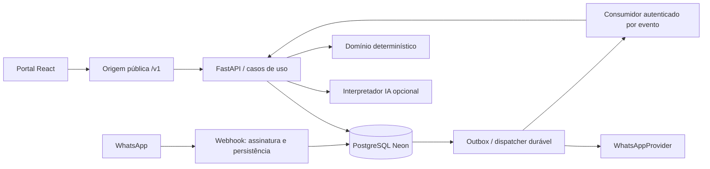

# Arquitetura proposta

Este documento registra o desenho original. Consulte o [índice técnico](README.md) e o [roteiro de release](release-runbook.md) para a operação vigente.

Status: arquitetura alvo F1; fundação parcialmente implementada na F2 (ver atualização ao final). Requisitos: RF-CV, RF-AG, RF-IA, seções 5, 7 e 12 do Master.

Nenhuma transação inclui chamadas externas. Webhook só ACK após persistência; falha antes do commit resulta em resposta de falha para retry do provedor. Mensagens de saída são criadas na outbox no mesmo commit do resultado de negócio. Entrega externa pode ser ao menos uma vez; não prometer exactly-once sem suporte do provedor.

## Camadas e fronteiras

`backend/presentation` recebe HTTP, valida schemas e autentica. `application` coordena autorização, transações e portas. `domain` contém status, disponibilidade e regras puras. `infrastructure` implementa banco, criptografia e provedores. Dependências apontam para domínio; rotas e prompts não contêm regras de agenda.

Estrutura futura: `frontend/src/{app,features,shared,locales}`, `backend/{presentation,application,domain,infrastructure}`, `backend/migrations`, `tests/{unit,integration,security,e2e}`, `docs/`. Isso é plano, não diretórios já executáveis.

## Limites transacionais

- Cada requisição autenticada resolve usuário, membership ativo e tenant no servidor; troca de clínica exige validar membership e regenerar contexto.
- Consumidor resolve tenant pelo evento persistido, não pelo payload livre da fila. Lock de conversa e incremento de versão no commit; nada crítico apenas em memória.
- Funções têm duração limitada; consumidor processa lote limitado com lease e checkpoint. Trabalho pendente volta ao mecanismo durável.
- Outbox desacopla confirmação do envio: falha de WhatsApp não desfaz consulta confirmada. Consulta só é anunciada após commit.

## Portal proposto

Login/MFA/recuperação; agenda dia/semana; configuração de expediente/exceções; serviços; colaboradores; inbox; auditoria; integrações write-only; gestão de clínicas. Cada tela tem loading, vazio, erro e acesso negado. Navegação por teclado, foco visível, rótulos, contraste e mensagens de erro associadas são critérios de e2e/axe. Cache deve ser limpo em logout/troca de clínica; chaves incluem escopo autenticado.

## Atualização F2 · 31/10/2026

Este documento conserva o design completo da F1. O subconjunto implementado e validado nesta fase, com limites e comandos, está em [foundation.md](foundation.md) e no [relatório F2](reports/f2-foundation.md). Funcionalidades futuras aqui descritas não foram declaradas implementadas.

## Atualização F3 · 31/10/2026

A F3 acrescentou o motor de agendamento, comandos na camada de aplicação, domínio puro, persistência e eventos transacionais. Ver [implementação F3](scheduling-implementation.md).
