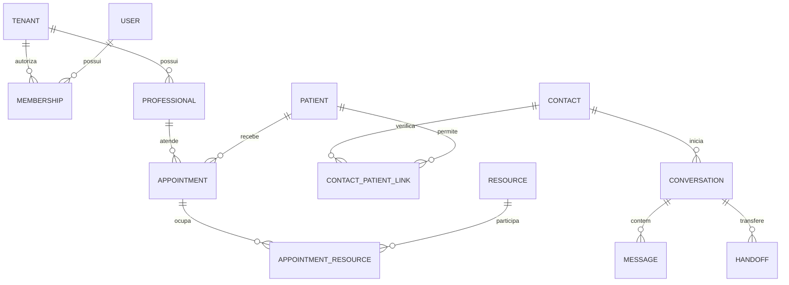

# Modelo lógico proposto

Status: modelo alvo F1; o subconjunto F2 possui DDL e migração testados (ver foundation.md). UUID como PK; timestamps UTC. Entidades clínicas usam tenant e vínculos compostos para impedir referências cruzadas; a tabela abaixo é o alvo completo, não afirma que todas já existem. Identidade e roteamento são exceções globais restritas.

| Entidades | Campos e relações principais | Constraints / índices |
|---|---|---|
| tenants, units, resources | tenant: timezone IANA/status; unit pertence a tenant; resource pertence a unit, capacity=1 | slug único; `(tenant_id,unit_id)` |
| users, roles, permissions, role_permissions | identidade global, password_hash, MFA; catálogo de ações | login normalizado único; segredo MFA criptografado |
| memberships, membership_roles, professional_assignments, queue_memberships | user/tenant/role, profissional e filas permitidos | vínculos únicos compostos; revogação imediata |
| professionals, services, professional_services | ativo, serviço requer profissional, duração, políticas | duração positiva; par profissional/serviço único |
| contacts, patients, contact_patient_links | telefone cifrado + HMAC para busca; paciente mínimo cifrado; vínculo com nível/data de verificação e evidência mínima | HMAC de telefone único por tenant; patient não é único por nome/nascimento; vínculo único e revogável |
| professional_schedules | profissional, dia local, início/fim, vigência, unit | fim > início; índice tenant/profissional/vigência |
| schedule_exceptions, blocked_periods, holidays | intervalos UTC e recorrência local explícita; escopo unit/profissional | intervalo não vazio; índice por escopo/data |
| appointments | patient, contact solicitante, service, professional, unit, intervalo, status, version, replaced_by_id | duração > 0; exclusion por tenant/profissional/intervalo para scheduled/confirmed; chave idempotente única |
| appointment_resources | appointment, resource, intervalo e estado de ocupação | exclusão por tenant/resource/intervalo; trigger/rotina transacional mantém intervalo/status sincronizados |
| appointment_holds, hold_resources | dono contato/sessão, profissional, intervalo, expires_at, consumed_at | consulta por profissional/expiração; recursos bloqueados sob mesmos locks; hold não persistido como appointment |
| appointment_transitions | appointment, from/to, ator, motivo e correlation_id | append-only; ordenação temporal por appointment |
| conversations, conversation_state | contact/canal, state, schema_version, version, context mínimo | uma conversa aberta por contato/número; versão não negativa |
| messages | conversa, provider_message_id, direction, ciphertext, key_version, status | identificador de mensagem único por provedor/conta; paginação conversa/data/id |
| handoffs, service_queues | fila, conversa, motivo, assignee, estado e lease | um handoff aberto por conversa; índices fila/status/data |
| webhook_events | provider, account, event_key, digest, payload cifrado mínimo, received_at, processed_at | unique provider/account/event_key; retenção do payload definida separadamente |
| outbox, jobs | tenant, event/type, aggregate_id/version, attempts, next_attempt_at, lease_until, status | event_key único; índice parcial para pendentes; DLQ |
| ai_usage | tenant, período, tokens reservados/usados, modelo, latência, resultado | reserva de cota atômica; sem prompts |
| audit_logs | tenant, ator opaco, ação, recurso opaco, resultado, motivo, correlation_id | runtime só INSERT; índice tenant/data/id |
| consents | contact/patient, finalidade, versão do aviso, origem, estado e data | histórico append-only; consentimento não substitui base legal |
| integration_configs, provider_routes | ciphertext/versão da chave por tenant; route account/phone_number_id → tenant | route única global; leitura restrita, segredo write-only |
| sessions, recovery_tokens, mfa_challenges | user, membership ativo, hash do token, expiração/revogação | token único; uso único para recuperação/desafio |
| break_glass_grants, rate_limit_buckets, idempotency_records | escopo/expiração; contador por chave/janela; request_hash e resposta mínima cifrada | unicidade por chave escopada; expiração e auditoria |

## Relações centrais

Soft delete/desativação em serviços e profissionais com histórico. Não apagar appointment para cancelar. Dados pessoais sujeitos a descarte/anônimização por rotina privilegiada aprovada; remover chaves/vínculos conforme política sem apagar indevidamente registros obrigatórios. Nenhum cascade amplo para dados auditados. Migrações terão upgrade do zero/com dados; rollback destrutivo exige plano explícito, não downgrade automático de produção.

## Atualização F2 — 31/10/2026

Este documento conserva o design completo da F1. O subconjunto implementado e validado nesta fase, com limites e comandos, está em [foundation.md](foundation.md) e no [relatório F2](reports/f2-foundation.md). Funcionalidades futuras aqui descritas não foram declaradas implementadas.

## Atualização F3 — 31/10/2026

A migração 0002 acrescenta serviços/habilitações, agendas/exceções/bloqueios/feriados, contatos/pacientes/vínculos, holds/appointments/recursos/transições, conversa mínima, idempotência e outbox. Todas essas entidades têm RLS e FKs escopadas. O DDL congelado está em backend/migrations/versions/0002_scheduling.py; ver [guia F3](scheduling-implementation.md).
